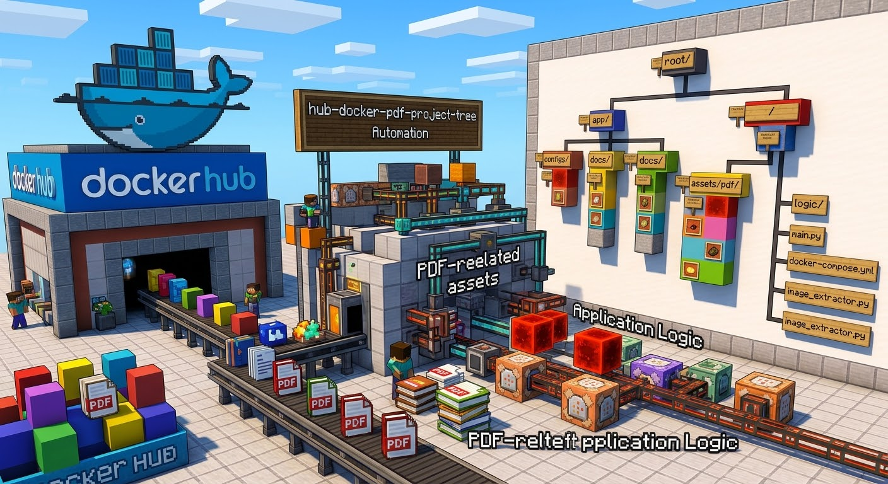

## 🧰 Tech Stack & Architecture

### 💻 Core Programming Languages & Core Systems


---

### ⚙️ Platform Support & Hardware Architecture


---

### ⚡ Low-Level Infrastructure & Performance


---

### 🛡️ Cybersecurity & Offensive Auditing


---

### 🛠️ DevOps & Build Tools


---

### 🧠 Artificial Intelligence & Quantum


---

### ☁️ Cloud Providers


## hub-docker-pdf-project-tree

[](https://github.com/sarasanner33-create/hub-docker-pdf-project-tree/actions/workflows/generate-tree.yml)
[](https://github.com/sarasanner33-create/hub-docker-pdf-project-tree/actions/workflows/docker-publish.yml)


---

### What is this about?
Imagine you have a giant toy box sent from the internet (that's a Docker container). You want to know what is inside without pulling everything out onto your bedroom floor one by one. This project is like a super-smart robot helper that looks inside that toy box, finds all the PDF toys and papers, and draws a neat map of where everything lives!

### What this does?
1. It downloads any computer program package (Docker image) from the internet.
2. It opens it up safely in a pretend workspace.
3. It searches for anything related to PDFs and important code.
4. It draws a clean map (a tree diagram) so you can see all the folders and files instantly!

### Why is this cool?
Normally, looking inside a Docker app is super hard—like trying to look inside a locked treasure chest. With this tool, you press a button, and *bam!* You get a crystal-clear map of all its files and folders right on your screen. 

### What problems this solves?
Have you ever tried to look inside a pre-made computer app and gotten totally lost in millions of system files? This tool solves that by hiding all the boring system junk and only showing you the fun PDF and code parts in a neat picture map.

### How does this works? Step-by-step
* **Step 1:** The script reaches out to the internet and grabs the Docker app you asked for.
* **Step 2:** It unpacks all the files into a temporary folder.
* **Step 3:** A python helper program sifts through everything and keeps only the cool PDF and code files.
* **Step 4:** Another python helper draws a branch-by-branch map and saves it into a file called `TREE.md`.

### How to install this?
1. Download or clone this project folder to your computer.
2. Open your terminal window inside the folder.
3. Turn on the helper permissions by typing:
   ```bash
   bash scripts/25_audit_permissions.sh

————————————————————————
   hub-docker-pdf-project-tree/
├── .github/
│   └── workflows/
│       ├── docker-publish.yml
│       └── generate-tree.yml
├── extracted-fs/              # (Hidden folder) Where the docker app is opened
├── filtered-pdf-fs/           # (Hidden folder) Where the saved PDF files live
├── output/
│   ├── TREE.md                # The final map picture!
│   ├── structure.json         # Map data in computer language
│   └── manifest.json          # Security check list
├── scripts/                   # The 30 robot helper scripts
│   ├── 01_pull_image.sh
│   ├── ...
│   └── 30_test_suite.py
├── .dockerignore
├── .gitignore
├── Dockerfile
├── docker-compose.yml
├── README.md
└── requirements.txt
